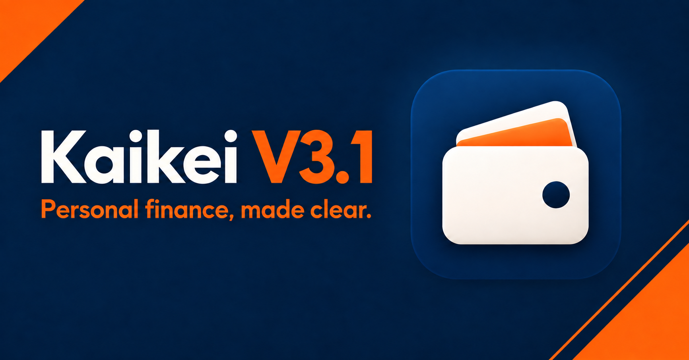

# Kaikei Demo V3.10.2

<p align="center"></p>

The current Kaikei interface with fictional finances and browser-only saves.

[Open the demo](https://kaikei-demo-2026.ktanzyl.chatgpt.site/)

## Try it

- Explore balances, cash flow, weekly guides, estimate checks, and monthly reviews.
- Add one transaction or a batch; edit dates/months, filter, repeat a purchase, or delete with Undo.
- Open colour-coded daily groups or jump to a week's transactions.
- Edit categories, estimates, Actuals, recurring plans, and full credit-card bills minus fixed costs (excluding rent).
- Export/rehearse a fictional backup, view History, switch themes, or reset.

<details>
<summary><strong>Recent highlights — V3.10.2</strong></summary>

- Current production UI, including the duplicate-row and modal-footer fixes.
- Daily groups, filters, Undo, duplicate checks, and recent-purchase shortcuts.
- Recurring month setup, category editing/reordering, export and rehearsal.
- Lazy startup/feedback, offline shell caching, and responsive layout polish.
- Browser-local persistence; unused database code removed and server writes blocked.

[Demo release history](CHANGELOG.md)

</details>

## Safety and persistence

All bundled finances are fictional. No production workbook, records, tokens, or spreadsheet configuration are included. No Google Sheet or private app is connected, and visitors never share records.

Records/receipts use `kaikei-demo-ledger-v2` in localStorage. Older demo data migrates without deleting the original copy. Corrupt/failed storage shows an error rather than silently discarding data. Saves work offline after the shell is cached. Same-origin tabs share a local ledger; Web Locks coordinate writes where supported.

**Reset demo** removes only Kaikei-owned data on this separate origin. Other websites and the private app are unaffected. Do not enter real financial information. Clearing browser data or switching devices loses the demo session.

## Demo versus private app

The UI and client safeguards are shared. Google Sheet sync/formatting/timers, server-side month partitions/daily backups, and the native iOS target are deliberately excluded. Month setup and bill calculations are local simulations.

## Development

Requires Node.js 22.13+ and npm; use Node.js 24 for tests.

```bash
npm ci
npm run dev
npm test
npx tsc --noEmit --incremental false
npm run build
npm run check:startup-bundle
npm run check:demo-safety
```

No credentials or environment variables are needed. Install from Safari using **Share → Add to Home Screen**.

UI lives in `app/kaikei-app.tsx` and lazy view/dialog modules. `lib/demo-runtime.ts` handles browser-only operations; `lib/demo-seed.ts` extends the fictional seed. Hosted API routes reject server-ledger access.

[UI provenance](docs/UPSTREAM.md). Source/markup tests do not guarantee every device's appearance or measure iPhone launch time.
